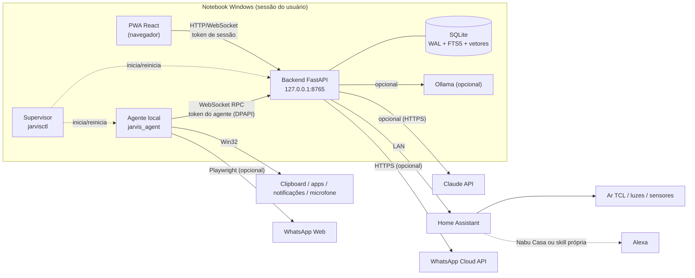
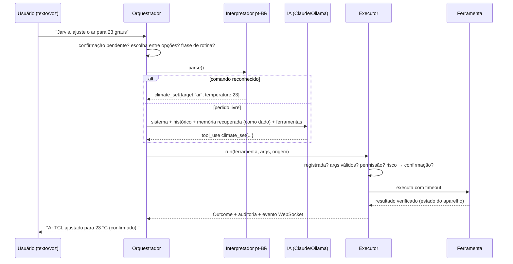
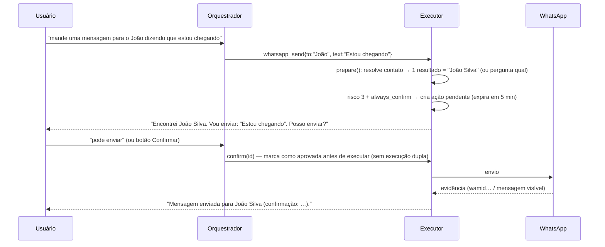
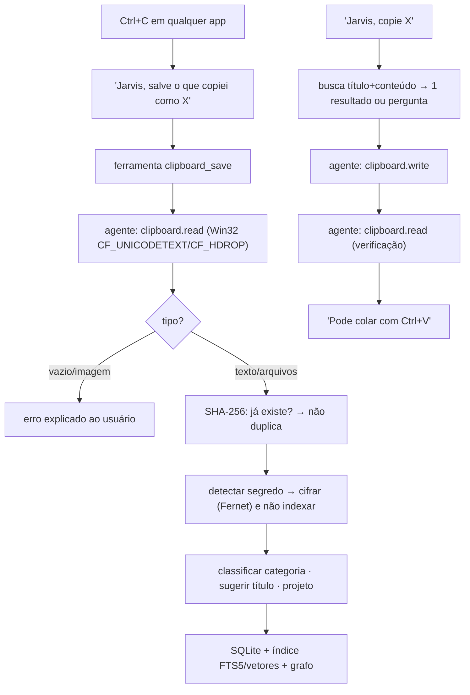

# Arquitetura do JARVIS

## Visão geral

**Princípios:**
- **Local primeiro.** Tudo roda no notebook; a nuvem é opcional e substituível.
- **Ferramentas registradas são a única forma de agir.** A IA não executa comandos; ela pede ferramentas, e cada pedido passa por validação, política e, quando necessário, confirmação humana.
- **Falhas isoladas.** Sem IA, o interpretador determinístico atende os comandos. Sem agente, as ferramentas de desktop informam o motivo. Sem Home Assistant ou WhatsApp, apenas aqueles módulos ficam indisponíveis.
- **Resultados verdadeiros.** Ações verificam o efeito: o estado do dispositivo após o comando, o clipboard relido após a escrita, o ID da mensagem retornado pela Meta e a mensagem visível no WhatsApp Web.

## Componentes

| Componente | Responsabilidade | Código |
|---|---|---|
| Orquestrador | decide o caminho de cada pedido; mantém o contexto da conversa | `backend/app/orchestrator/orchestrator.py` |
| Interpretador pt-BR | ~40 regras offline (clipboard, memória, casa, WhatsApp, rotinas, sistema) e normalização de transcrições | `orchestrator/intents.py`, `dateparse.py`, `textnorm.py` |
| Registro de ferramentas | nome, descrição, parâmetros Pydantic (`extra=forbid`), permissão, nível de risco, timeout, confirmação, preparação | `orchestrator/registry.py`, `backend/app/tools/*` |
| Política | permissões desativadas, níveis que exigem confirmação, modo de emergência, regra de conteúdo não confiável | `orchestrator/policy.py` |
| Executor | valida, decide, cria ações pendentes, executa com timeout, audita, publica eventos | `orchestrator/executor.py` |
| Provedores de IA | Claude (SDK oficial `anthropic`), compatível com OpenAI (Ollama, LM Studio, outros), fallback, orçamento, métricas | `backend/app/providers/` |
| Segundo cérebro | memórias tipadas com origem, data, estado e confiança; projetos; tarefas; lembretes; documentos; grafo; consolidação | `backend/app/memory/` |
| Índice híbrido | trechos no SQLite, FTS5 (BM25, sem acentos) + vetores (cosseno), combinados por Reciprocal Rank Fusion | `memory/index.py` |
| Clipboard | salvar sob demanda, classificar, deduplicar, cifrar segredos, buscar, copiar de volta, histórico, exportar | `backend/app/clipboard_memory/` |
| Integrações | Home Assistant (REST), TCL via HA, Alexa via HA, WhatsApp (notificações / Web / Cloud API) | `backend/app/integrations/` |
| Agente local | lista fechada de métodos RPC: clipboard Win32, apps, URLs, arquivos, comandos aprovados, notificações, voz, WhatsApp Web | `desktop/jarvis_agent/` |
| Segurança | scrypt + sessões opacas, Fernet + DPAPI, detecção de segredos, CSP, CORS restrito | `backend/app/security/`, `main.py` |
| Supervisor | processo único, reinício controlado (código 3), recuperação com espera crescente, encerramento limpo | `scripts/jarvisctl.py` |

## Fluxo de um pedido

## Fluxo de confirmação (ações sensíveis)

Uma confirmação só vale quando vem do **usuário autenticado**: digitada na conversa, dita por voz ou clicada no botão. A IA não pode confirmar nada: o loop de ferramentas para assim que surge uma ação pendente.

## Fluxo do clipboard

## Memória e RAG

- **Memória de trabalho:** estado por conversa (último registro citado, últimas fontes, opções pendentes) e as últimas N mensagens.
- **Memória persistente:** tabela `memories` com `kind` (episódio, fato, preferência, projeto, ideia, decisão, nota, aprendizado, objetivo, evento, resumo de sessão), `status` (explícita, confirmada, inferida, desatualizada, contraditória, rejeitada), `confidence`, `source`, `source_ref`, `happened_at`.
- **Recuperação:** a cada pedido livre, até `rag_top_k` trechos relevantes entram no contexto dentro de `<memoria_recuperada>`, com a citação de cada um. Trechos marcados como desatualizados ou inferidos aparecem sinalizados.
- **Esquecer:** apagar uma memória remove também os trechos, o FTS, os vetores, as ligações e as relações do grafo derivadas dela, e as entidades que ficarem órfãs.
- **Consolidação (em segundo plano):** gera somente inferências para revisão: resumo de sessão, decisões, pendências, ideias, duplicatas por similaridade de vetores, contradições entre preferências e conexões entre entidades.

## Dados

Todos os dados ficam em `data/` (configurável por `JARVIS_DATA_DIR`): `jarvis.db` (SQLite em WAL), `secrets/` (chave-mestra protegida por DPAPI, segredos cifrados e token do agente), `library/` (cópias dos documentos importados), `logs/` (JSON com rotação e segredos mascarados), `backups/`, `models/` (Whisper, Piper) e `whatsapp-session/`. Nada disso é versionado; veja o `.gitignore`.

## Decisões arquiteturais

| Decisão | Motivo | Alternativa considerada |
|---|---|---|
| SQLite único (FTS5 + vetores em BLOB) | zero instalação, backup trivial, rápido para um acervo pessoal (36 ms para buscar em 10 mil memórias neste ambiente de teste) | sqlite-vec / Chroma / Postgres: adotar se passar de cerca de 200 mil trechos |
| Grafo relacional em SQLite | consultas simples (vizinhos, "quais projetos usam X") e sem novo serviço | Neo4j: complexidade sem benefício nessa escala |
| Interpretador determinístico antes da IA | funciona offline, sem custo, previsível e com latência abaixo de 3 ms | só LLM: caro, lento e indisponível sem internet |
| Agente separado do backend | clipboard, microfone e janelas exigem a sessão interativa do usuário; menor privilégio | tudo no backend: mistura responsabilidades |
| Lista fechada de RPC no agente | defesa em profundidade, mesmo com o backend comprometido | executar comandos genéricos: inaceitável |
| Embeddings por hashing como padrão | funciona em qualquer máquina sem baixar modelos; Ollama melhora a semântica | só neural: dependência obrigatória |
| SDK oficial `anthropic` para o Claude; HTTP genérico para OpenAI/Ollama | correção da API e suporte a fallback de recusa; o formato OpenAI cobre Ollama e LM Studio | — |
| Histórico do turno só cresce (append-only) | mantém válidos os blocos de raciocínio do Claude e o cache | — |
| Supervisor em Python (sem serviço do Windows) | não exige administrador, roda na sessão do usuário (necessário para clipboard/voz) | Serviço do Windows: roda na sessão 0, sem acesso ao clipboard |
