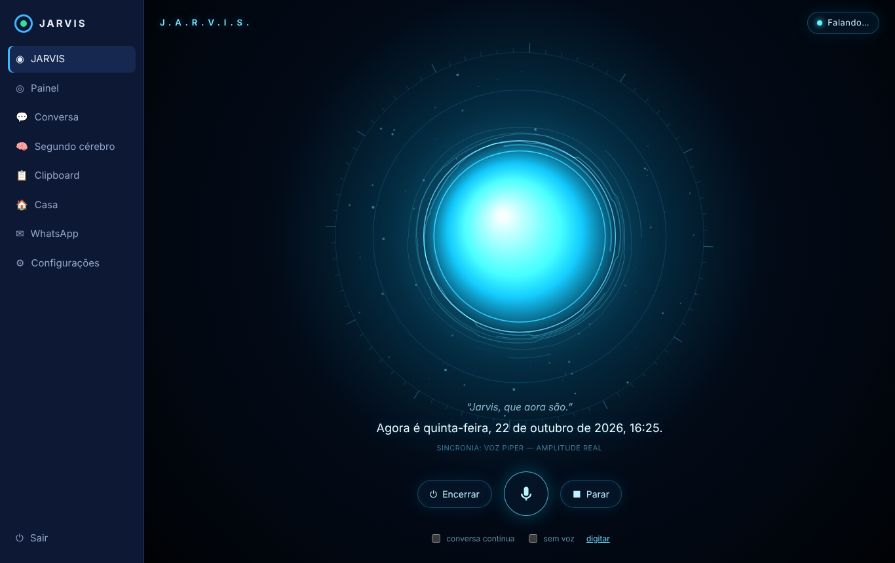

# Interface de voz — AI Voice Orb

A tela inicial do JARVIS (menu **JARVIS**, endereço `/#/jarvis`) é um orb holográfico ciano que reage ao **áudio real**: o microfone enquanto ouve e a voz sintetizada enquanto fala.

Vídeo da validação (sem som; o orb foi dirigido por áudio real durante a gravação): [media/orb-demo.mp4](media/orb-demo.mp4).

## Estados
| Estado | O que você vê | O que dirige a animação |
|---|---|---|
| Desligado | orb apagado | — |
| Iniciar / Encerrar | o orb acende ou apaga gradualmente (≈1 s), com HUD e brilho | transição interpolada |
| Repouso | respiração lenta (±3,5%), halo suave, marcações girando devagar | relógio (o único movimento sem áudio) |
| Ouvindo | três anéis polares deformados pelo **espectro do microfone** (32 faixas log 80 Hz–8 kHz); ondas nos picos | `AnalyserNode` do microfone |
| Processando | núcleo recolhe, arcos giram em sentidos opostos, partículas em órbita | estado do backend (transcrição, pedido em andamento, preparo da voz) |
| Falando | núcleo **expande e contrai com a amplitude** da voz, brilho acompanha, ondas a cada sílaba forte | `AnalyserNode` ligado ao áudio do TTS |
| Erro | tom âmbar por ~2 s | — |

As transições entre estados são interpolações exponenciais independentes da taxa de quadros: não há saltos, mesmo trocando de estado no meio de uma animação.

## Sincronia com o áudio (o que é real e o que não é)
| Fonte da voz | Sincronia | Observação |
|---|---|---|
| Microfone do navegador | **amplitude e espectro reais** | Web Audio API |
| Piper (voz neural local) | **amplitude e espectro reais** | o padrão `tts_engine = auto` usa o Piper quando instalado |
| Voz do navegador (speechSynthesis) | **por palavra** | o navegador não expõe o áudio gerado; o orb pulsa a cada evento de palavra e indica "sincronia por palavra" |
| Microfone/voz do PC (agente) | **amplitude real**, medida no agente e enviada ~25 vezes/s pelo WebSocket | com SAPI (sem Piper), um pulso por palavra |

A legenda mostra qual fonte está dirigindo a animação no momento ("sincronia: voz Piper — amplitude real", por exemplo).

**Medido no teste ponta a ponta** (Chromium com microfone alimentado por uma frase falada, transcrição local e resposta falada pelo Piper):
- correlação entre a amplitude da voz e o raio do núcleo: **0,99**;
- o raio variou de 103 a 162 px durante a fala;
- nível do microfone de até 0,99 durante a escuta;
- sequência de estados: ouvindo → processando → falando → repouso, sem erros no console.

## Uso
- **Iniciar** acende o JARVIS; **Encerrar** apaga e interrompe microfone e fala.
- **Microfone** (ou tecla **Espaço**): fale. A gravação termina sozinha após ~1,1 s de silêncio, ou clique de novo para enviar.
- **Esc** ou **Parar**: interrompe a fala, a escuta e o pedido em andamento.
- **Conversa contínua**: depois de responder, o JARVIS volta a ouvir automaticamente.
- **Sem voz**: responde só na legenda. **Digitar**: campo de texto.
- Confirmações de ações sensíveis aparecem num cartão no canto: responda "sim" por voz ou clique em Confirmar.

## Desempenho e acessibilidade
- Canvas 2D sem bibliotecas: ~70 partículas, 3 anéis de 128 pontos, gradientes. Leve para gráficos integrados. A resolução é limitada a 2× e a animação pausa sozinha com a aba em segundo plano.
- `prefers-reduced-motion`: partículas desligadas e amplitudes reduzidas.
- Estados anunciados por `aria-live`; todos os controles são acessíveis pelo teclado.

## Código
- `frontend/src/orb/audio.ts`: medidores (RMS → dB, faixas log, envelope por palavra).
- `frontend/src/orb/engine.ts`: estados, interpolação e desenho.
- `frontend/src/orb/OrbCanvas.tsx`: laço de animação e redimensionamento.
- `frontend/src/pages/Orb.tsx`: sessão de voz, legendas e controles.
- `desktop/jarvis_agent/voice.py`: `emit_level` (níveis do microfone e do Piper no PC).
- Testes: `frontend/tests/orb.test.tsx` (unitários) e `scripts/orb_e2e.py` (ponta a ponta com áudio real).
