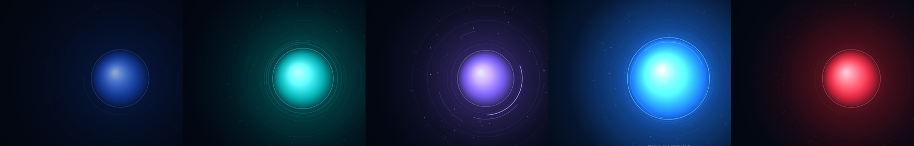

# Interface de voz — AI Voice Orb

A tela inicial do JARVIS (menu **JARVIS**, endereço `/#/jarvis`) é um orb holográfico que reage ao **áudio real**: o microfone enquanto ouve e a voz sintetizada enquanto fala. A cor e a animação indicam o estado real do assistente.



Vídeo da validação (sem som; o orb foi dirigido por áudio real durante a gravação, incluindo uma falha simulada no fim): [media/orb-demo.mp4](media/orb-demo.mp4).

## Estados visuais
| Estado | Cor | Animação | O que dirige |
|---|---|---|---|
| `OFF` | apagado | o orb acende/apaga gradualmente (≈1 s) ao iniciar/encerrar | botão Iniciar/Encerrar |
| `IDLE` | azul profundo `rgb(24,78,210)` | pulso lento (±3%, 0,25 Hz), brilho baixo | relógio (é o único estado animado sem áudio) |
| `LISTENING` | verde-ciano `rgb(0,228,180)` | o núcleo expande e contrai com a **intensidade da voz**; anéis externos deformados pelo **espectro do microfone**; ondas apenas quando há energia de voz; brilho maior | `AnalyserNode` do microfone (ou nível do microfone do PC) |
| `THINKING` | violeta `rgb(140,82,255)` | anéis girando em sentidos opostos, partículas discretas, pulso mais rápido (1,4 Hz); brilho moderado | estado funcional (transcrição ou pedido à IA em andamento) |
| `SPEAKING` | azul elétrico `rgb(0,136,255)` + ciano | núcleo e brilho seguem a **amplitude real do TTS**; ondas concêntricas propagadas pela energia da fala; brilho intenso com bloom suave | `AnalyserNode` ligado ao áudio do TTS (ou nível do Piper no PC) |
| `ERROR` | vermelho `rgb(255,42,64)` | 3 pulsos curtos (0,32 s cada) e depois brilho estável; o motivo aparece na legenda | falha real de microfone, transcrição, IA ou síntese |

Cor, brilho, escala e velocidade são interpolados exponencialmente (independente da taxa de quadros), então a troca de estado é suave mesmo no meio de uma animação. Em `IDLE` e `THINKING` o áudio não altera nada. As ondas nascem de um acumulador de energia do áudio: silêncio não gera ondas, e mais volume gera mais ondas.

## Máquina de estados
`frontend/src/orb/stateMachine.ts` é uma máquina de estados explícita. Uma tabela define, para cada estado, quais eventos são aceitos. Eventos que não se aplicam ao estado atual são ignorados (por exemplo, `TTS_ENDED` em repouso). O orb desenha **sempre** o estado da máquina, e a máquina só muda com eventos funcionais reais:

| Evento | Quando é disparado |
|---|---|
| `SESSION_START` / `SESSION_END` | Iniciar / Encerrar |
| `MIC_STARTED` | o gravador do microfone realmente começou (ou o agente informou que está ouvindo) |
| `MIC_STOPPED` | a gravação parou sem fala |
| `PROCESSING_STARTED` | transcrição ou pedido enviado ao backend |
| `PROCESSING_DONE` | resposta concluída sem fala (modo sem voz) |
| `TTS_STARTED` | o áudio da resposta **começou a tocar** (`playing` do elemento de áudio, `start` da speechSynthesis, ou o agente) |
| `TTS_ENDED` | o áudio terminou ou foi interrompido |
| `FAILED` | falha de microfone, transcrição, IA ou síntese (válido em qualquer estado ativo) |
| `RECOVER` | 2,6 s depois do erro |
| `CANCEL` | Esc / Parar |

```
OFF ─SESSION_START→ IDLE ─MIC_STARTED→ LISTENING ─PROCESSING_STARTED→ THINKING ─TTS_STARTED→ SPEAKING ─TTS_ENDED→ IDLE
                     ▲                                                     │ PROCESSING_DONE
                     └─────────────────────────────────────────────────────┘
qualquer estado ativo ─FAILED→ ERROR ─RECOVER→ IDLE · SPEAKING ─MIC_STARTED→ LISTENING (interrupção)
```

O estado `THINKING` permanece até o áudio realmente começar, para não piscar "repouso" entre a resposta e a fala. O histórico de transições fica disponível em `window.__jarvisMachine()` para diagnóstico.

## Sincronia com o áudio (o que é real e o que não é)
| Fonte da voz | Sincronia | Observação |
|---|---|---|
| Microfone do navegador | **amplitude e espectro reais** | Web Audio API |
| Piper (voz neural local) | **amplitude e espectro reais** | o padrão `tts_engine = auto` usa o Piper quando instalado |
| Voz do navegador (speechSynthesis) | **por palavra** | o navegador não expõe o áudio gerado; o orb pulsa a cada evento de palavra e indica "sincronia por palavra" |
| Microfone/voz do PC (agente) | **amplitude real**, medida no agente e enviada ~25 vezes/s pelo WebSocket | com SAPI (sem Piper), um pulso por palavra |

A legenda mostra qual fonte está dirigindo a animação no momento ("sincronia: voz Piper — amplitude real", por exemplo).

**Medido no teste ponta a ponta** (Chromium com microfone alimentado por uma frase falada, transcrição local e resposta falada pelo Piper):
- correlação entre a amplitude da voz e o raio do núcleo: **0,99**;
- o raio variou de 103 a 165 px durante a fala, e o brilho de 0,7 a 1,7;
- nível do microfone de até 0,99 durante a escuta;
- até 8 ondas concêntricas simultâneas durante a fala e até 2 durante a escuta;
- cores medidas no motor: repouso `24,79,211`, ouvindo `0,228,180`, processando `140,82,255`, falando `0,136,255`, erro `255,42,64`;
- histórico da máquina: `OFF→IDLE (SESSION_START)`, `IDLE→LISTENING (MIC_STARTED)`, `LISTENING→THINKING (PROCESSING_STARTED)`, `THINKING→SPEAKING (TTS_STARTED)`, `SPEAKING→IDLE (TTS_ENDED)`; com o backend respondendo 500: `IDLE→THINKING`, `THINKING→ERROR (FAILED)`, 3 pulsos no raio (≈118 px), raio estável em 109 px, `ERROR→IDLE (RECOVER)`;
- único erro no console: o próprio 500 simulado.

## Uso
- **Iniciar** acende o JARVIS; **Encerrar** apaga e interrompe microfone e fala.
- **Microfone** (ou tecla **Espaço**): fale. A gravação termina sozinha após ~1,1 s de silêncio, ou clique de novo para enviar.
- **Esc** ou **Parar**: interrompe a fala, a escuta e o pedido em andamento.
- **Conversa contínua**: depois de responder, o JARVIS volta a ouvir automaticamente.
- **Sem voz**: responde só na legenda. **Digitar**: campo de texto.
- Confirmações de ações sensíveis aparecem num cartão no canto: responda "sim" por voz ou clique em Confirmar.

## Desempenho e acessibilidade
- 60 quadros/s só em LISTENING e SPEAKING (quando a animação segue o áudio); 30 nos demais estados. O fundo de tela inteira fica em cache, e a resolução interna cai sozinha se um quadro passar de ~9 ms. Medido: com o orb aberto num navegador sem aceleração de vídeo, a transcrição local passou de 3,55 s para 2,3 s (antes, a animação disputava a CPU com o Whisper).
- O menu lateral fica fechado: ☰ no canto abre a gaveta, que fecha ao escolher uma tela, ao clicar fora ou com Esc.
- Canvas 2D sem bibliotecas: ~70 partículas, 3 anéis de 128 pontos, gradientes. Leve para gráficos integrados. A resolução é limitada a 2× e a animação pausa sozinha com a aba em segundo plano.
- `prefers-reduced-motion`: partículas desligadas e amplitudes reduzidas.
- Estados anunciados por `aria-live`; todos os controles são acessíveis pelo teclado.

## Código
- `frontend/src/orb/audio.ts`: medidores (RMS → dB, faixas log, envelope por palavra).
- `frontend/src/orb/stateMachine.ts`: máquina de estados (tabela de transições).
- `frontend/src/orb/useAssistantMachine.ts`: hook com histórico de transições.
- `frontend/src/orb/engine.ts`: estilo de cada estado, interpolação, ondas por energia, pulsos de erro e desenho.
- `frontend/src/orb/OrbCanvas.tsx`: laço de animação e redimensionamento.
- `frontend/src/hooks/useVoice.ts`: emite os eventos reais de microfone e TTS.
- `frontend/src/pages/Orb.tsx`: converte eventos em transições, legendas e controles.
- `desktop/jarvis_agent/voice.py`: `emit_level` (níveis do microfone e do Piper no PC).
- Testes: `frontend/tests/orb.test.tsx` (unitários) e `scripts/orb_e2e.py` (ponta a ponta com áudio real).
